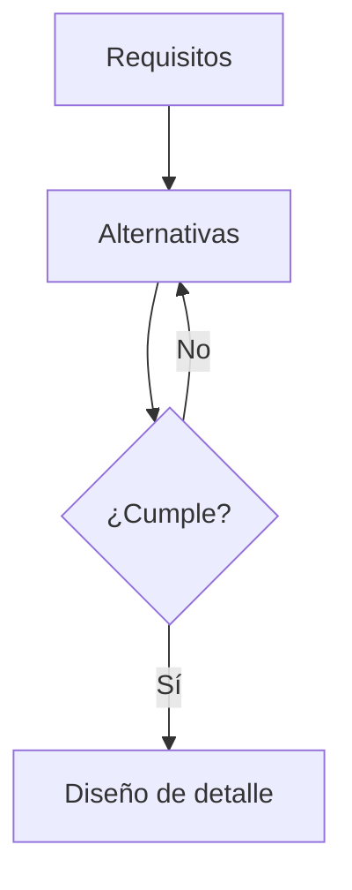

# Cómo agregar contenido al portafolio

Hay dos caminos. Usa el que te resulte más cómodo.

**Camino fácil:** envíale a Claude, en el hilo del proyecto, los textos e imágenes (aunque sean borradores o fotos de tus apuntes). Claude los convierte al formato correcto y abre un pull request para que lo revises.

**Camino directo:** edita los archivos tú mismo desde github.com, sin instalar nada. Los pasos están abajo.

Cada vez que un cambio llega a la rama `main`, el sitio se publica solo en unos 2 minutos en
https://olimacjuan.github.io/Portafolio/

---

## Dónde vive cada cosa

| Quiero cambiar…                  | Archivo o carpeta                                  |
| -------------------------------- | -------------------------------------------------- |
| Mi nombre, universidad, enlaces  | `src/config.ts`                                    |
| Un proyecto                      | `src/content/proyectos/<nombre-del-proyecto>/`     |
| Un tema teórico (libro de Conocimiento) | `src/content/fundamentos/<tema>.mdx`        |
| Una metodología (libro del primer estante de Conocimiento) | `src/content/metodologias/<metodo>.mdx` |
| Un modelo 3D (.glb)              | `public/modelos/`                                  |
| Los colores                      | `src/styles/global.css` (bloque `@theme`)          |

Los nombres de archivos y carpetas van en minúsculas, sin tildes ni espacios: `soporte-motor`, no `Soporte Motor`.

---

## Agregar un proyecto (post-it)

Cada proyecto es una carpeta con un archivo `index.mdx` y sus imágenes.

1. En GitHub, entra a `src/content/proyectos/`.
2. Pulsa **Add file → Create new file** y escribe como nombre `mi-proyecto/index.mdx` (la `/` crea la carpeta).
3. Pega la plantilla de abajo y llénala.
4. Sube la imagen principal a la misma carpeta con **Add file → Upload files** (ej. `portada.jpg`, ancho mínimo 1600 px).
5. Pulsa **Commit changes**. Elige "Create a new branch" si quieres revisarlo antes en un pull request.

```mdx
---
titulo: Nombre del proyecto
resumen: Una o dos frases (máximo 180 caracteres) que digan qué hiciste y para qué.
area: Diseño mecánico   # o: Térmicas y fluidos, Manufactura, Materiales, Dinámica y control
fecha: 2026-05-15
contexto: Materia o contexto (curso, semillero, práctica, personal)
miRol: Lo que hiciste tú
equipo:
  - nombre: Nombre de un compañero
    rol: lo que hizo
imagen: ./portada.jpg
imagenAlt: Descripción de la imagen para personas que no la ven
postit: amarillo        # o: cian, verde, blanco
destacado: false        # true para mostrarlo en la página de inicio
---

## Problema

## Requisitos y restricciones

## Metodología

## Diseño conceptual

## Análisis

## Resultados

## Lecciones aprendidas
```

Si el proyecto fue en equipo, pide permiso a tus compañeros antes de publicarlo. Si fue en una empresa o con datos de la universidad, confirma que puedes mostrarlo.

---

## Agregar un tema teórico (libro de la sección Conocimiento)

La sección **Conocimiento** es una biblioteca: el primer estante tiene las metodologías de diseño y los demás estantes, los fundamentos teóricos.

Crea `src/content/fundamentos/mi-tema.mdx`:

```mdx
---
titulo: Torsión en ejes circulares
estante: Mecánica de sólidos   # o: Diseño de máquinas, Termofluidos, Dinámica y vibraciones, Materiales y manufactura
resumen: Una frase sobre el tema.
lomo: cian                      # color del lomo: marino, cian, amarillo, azul, verde, gris
orden: 20                       # posición en el estante (menor = más a la izquierda)
borrador: false                 # true = se ve desvanecido y aún no se puede abrir
---

Aquí va el texto.
```

Ya hay libros creados como `borrador: true` (desvanecidos). Para escribir uno, abre su archivo, cambia a `borrador: false` y añade el texto debajo.

---

## Agregar una metodología

Crea `src/content/metodologias/mi-metodo.mdx` con `titulo`, `resumen`, `lomo` (color), `orden` y `borrador`, igual que los temas. Aparece como un libro en el estante "Metodologías de diseño".

---

## Escribir ecuaciones (KaTeX)

En medio de una frase, entre signos de dólar: `$\sigma = F/A$`.

En un bloque aparte, entre dobles signos de dólar:

```
$$
\sigma_{max} = \frac{M\, c}{I}
$$
```

Si no conoces LaTeX, toma una foto de tus apuntes y envíasela a Claude.

## Dibujar diagramas de flujo (Mermaid)

Escribe un bloque de código con la palabra `mermaid`:

````

````

Puedes probar tus diagramas en https://mermaid.live antes de pegarlos.

## Mostrar un modelo 3D

1. Exporta tu pieza desde SolidWorks, Fusion o Inventor como `.glb` (o envíale el STEP/STL a Claude para convertirlo). Intenta que pese menos de 5 MB.
2. Súbelo a `public/modelos/`.
3. En el `.mdx` del proyecto escribe:

```mdx
<ModeloCAD src="/modelos/mi-pieza.glb" alt="Ensamble del reductor" />
```

## Calculadora interactiva

En cualquier proyecto o tema puedes insertar la calculadora de vigas con `<CalculadoraViga />`. Si quieres otra calculadora (ejes, resortes, transferencia de calor), pídesela a Claude.

---

## Borrar los ejemplos

Lo marcado como **Ejemplo** está ahí para que veas el formato:

- `src/content/proyectos/ejemplo-soporte-motor/` (borra la carpeta cuando tengas tu primer proyecto)
- `src/content/fundamentos/flexion-en-vigas.mdx` (cámbialo por tu texto y quita `ejemplo: true`)
- `src/content/metodologias/vdi-2221.mdx` (igual)
