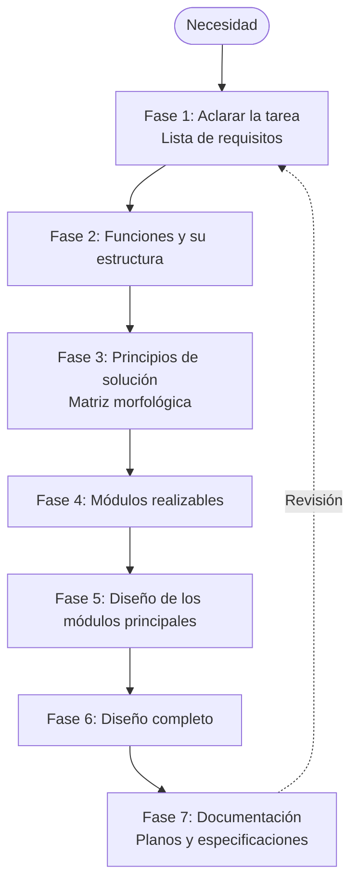

## Para qué sirve

La guía VDI 2221 de la Asociación de Ingenieros Alemanes ordena el diseño en fases. Cada fase produce un resultado concreto que se revisa antes de seguir, lo que evita saltar a la solución antes de entender el problema.

## Las fases

## Cómo la apliqué

En el [soporte para motor](../../../proyectos/ejemplo-soporte-motor/) usé las fases 1 a 3 para comparar tres geometrías antes de modelar en CAD.
