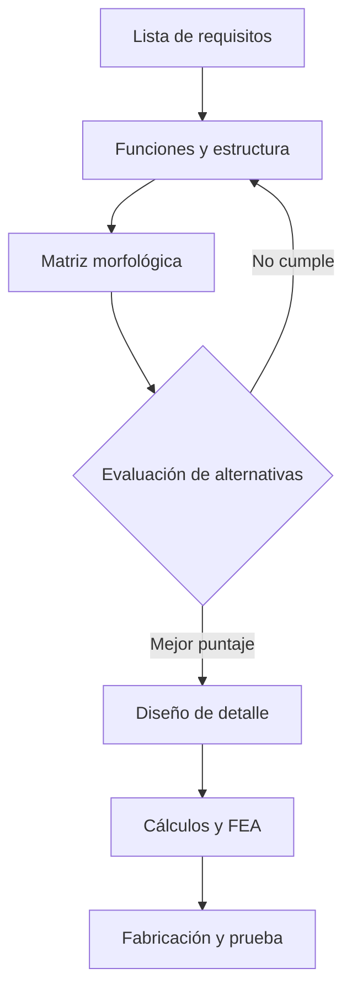

## Problema

El banco de pruebas del laboratorio necesitaba un soporte para montar un motor eléctrico de 2 kW. El soporte original vibraba a plena carga y se había fisurado cerca del doblez.

## Requisitos y restricciones

| Requisito | Valor |
| --- | --- |
| Masa del motor | 18 kg |
| Torque nominal | 13 N·m |
| Material disponible | Acero ASTM A36, lámina de 6 mm |
| Factor de seguridad mínimo | 2,0 |
| Presupuesto | 150 000 COP |

## Metodología

Seguí una versión simplificada de la VDI 2221: de la lista de requisitos a la evaluación de alternativas y la validación.

## Diseño conceptual

Comparé tres alternativas: soporte en L simple, soporte en L con nervio y soporte en U. El soporte con nervio obtuvo el mejor puntaje en rigidez por costo.

## Análisis

Modelé el brazo vertical como una viga en voladizo con la carga del motor en el extremo. El momento flector máximo en el doblez es

$$
M_{max} = F \cdot L
$$

y el esfuerzo normal máximo por flexión en una sección rectangular es

$$
\sigma_{max} = \frac{M_{max}\, c}{I} = \frac{6\, M_{max}}{b\, h^{2}}
$$

Con $F = 176{,}6\ \text{N}$, $L = 0{,}12\ \text{m}$, $b = 80\ \text{mm}$ y $h = 6\ \text{mm}$ se obtiene $\sigma_{max} \approx 44\ \text{MPa}$, y con $S_y = 250\ \text{MPa}$ el factor de seguridad estático es $n \approx 5{,}7$.

## Resultados

- La simulación por elementos finitos confirmó el esfuerzo máximo en el doblez, 12 % por encima del cálculo manual por la concentración de esfuerzos.
- El nervio de refuerzo redujo la deflexión en el extremo de 1,8 mm a 0,4 mm.
- El prototipo funcionó 20 horas a plena carga sin fisuras visibles.

## Lecciones aprendidas

Debí considerar la fatiga desde el principio: la falla del soporte original era por carga cíclica, no estática.
